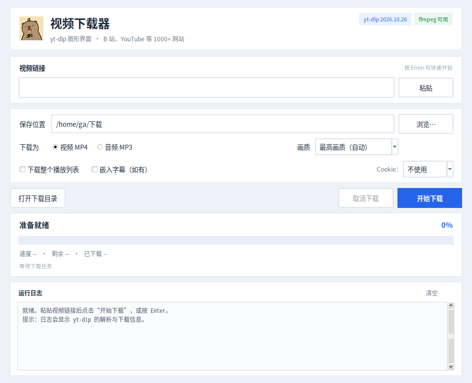

# 卡皮巴拉视频下载器

> 一个基于 **Tkinter + yt-dlp** 的跨平台桌面视频下载器，支持 B 站、YouTube 等 1000+ 网站。
>
> A capybara-themed desktop video downloader powered by Python, Tkinter and yt-dlp.

[](https://github.com/zga8888/study/actions/workflows/build.yml)
[](https://github.com/zga8888/study/releases/latest)
[](LICENSE)
[](https://www.python.org/)



## 下载

编译版由 GitHub Actions 自动构建，发布在 [Releases](https://github.com/zga8888/study/releases/latest)。

| 平台 | 文件 |
|---|---|
| Linux x86_64 | [CapybaraDownloader-linux-x86_64.tar.gz](https://github.com/zga8888/study/releases/latest/download/CapybaraDownloader-linux-x86_64.tar.gz) |
| Windows x64 | [CapybaraDownloader-windows-x64.zip](https://github.com/zga8888/study/releases/latest/download/CapybaraDownloader-windows-x64.zip) |

> 如果链接暂时返回 404，通常表示最新一次 Release 仍在构建中，请稍后刷新。

运行程序仍然需要系统中有 **yt-dlp** 和 **ffmpeg**。也可以把 `yt-dlp.exe` / `ffmpeg.exe` 放在程序旁边。

## 功能

- 粘贴链接即可下载，按 `Enter` 快速开始
- 视频下载：最高画质、4K、2K、1080p、720p、480p、360p
- 音频提取：MP3，可选 320 / 256 / 192 / 128 kbps
- 实时进度、速度、剩余时间、已下载大小
- 支持取消下载（会结束 yt-dlp 与 ffmpeg 子进程）
- 支持整个播放列表
- 可选嵌入中英文字幕
- 可选从 Chrome / Chromium / Firefox / Edge / Brave 读取 Cookie
- 自动记住保存目录、画质和选项
- 自动检测系统代理（YouTube 必需）
- 运行日志可复制，方便排查错误
- 卡皮巴拉图标与桌面快捷方式

## Linux 使用

下载并解压：

```bash
tar -xzf CapybaraDownloader-linux-x86_64.tar.gz
cd CapybaraDownloader-linux-x86_64   # 解压后的目录名以实际为准
./CapybaraDownloader/CapybaraDownloader
```

可选：安装应用菜单快捷方式和图标：

```bash
./install_linux.sh
```

依赖安装（Debian / Ubuntu / Linux Mint）：

```bash
sudo apt install python3-tk ffmpeg yt-dlp
```

如果系统仓库里的 yt-dlp 太旧，建议：

```bash
pipx install yt-dlp
# 或
sudo yt-dlp -U
```

## Windows 使用

1. 安装依赖（PowerShell）：

```powershell
winget install --id yt-dlp.yt-dlp -e --source winget
winget install --id Gyan.FFmpeg -e --source winget
```

2. 解压 `CapybaraDownloader-windows-x64.zip`，运行：

```text
CapybaraDownloader\CapybaraDownloader.exe
```

3. 需要固定到任务栏时：启动程序 → 右键任务栏图标 → **固定到任务栏**。

Windows 的更多说明、源码运行和自行打包步骤见 [windows/README-Windows.md](windows/README-Windows.md)。

> 未签名 exe 首次运行可能出现 SmartScreen 提示，点击“更多信息 → 仍要运行”。

## 从源码运行

要求 **Python 3.10+**、Tkinter、yt-dlp、ffmpeg。

```bash
# Linux / macOS
python3 yt_dlp_gui.py
```

```powershell
# Windows
python yt_dlp_gui.py
```

也可以使用 Linux 启动脚本：

```bash
./run_linux.sh
```

Windows 源码启动：

```text
windows\run_source.bat
```

## 使用说明

1. 粘贴视频链接（支持带分享文案的文本，程序会自动提取 URL）。
2. 选择保存位置、视频/音频、画质。
3. 点击“开始下载”，或按 `Enter`。
4. 下载完成后点击“打开下载目录”。

### 下载 B 站高画质 / 会员内容

1. 先在浏览器登录 B 站。
2. 在界面右下角 `Cookie` 下拉框选择浏览器。
3. 重新开始下载。

如果浏览器正在运行导致读取 Cookie 失败，先完全退出浏览器再试。

### YouTube 需要代理

在国内网络环境下，B 站可以直连，但 YouTube 通常必须走代理。

程序会自动读取：

- 环境变量 `HTTPS_PROXY` / `HTTP_PROXY`
- Linux 的 Cinnamon/GNOME 系统代理设置
- Windows 的“Internet 选项”系统代理

如果终端里的 `yt-dlp` 能下载 YouTube，而桌面启动的 GUI 不能，通常是因为终端有代理环境变量，而桌面进程没有继承。现在程序会直接读取系统代理，不再依赖终端环境。

自动检测失败时，可以编辑设置文件：

- Linux：`~/.config/yt-dlp-gui/settings.json`
- Windows：`%APPDATA%\yt-dlp-gui\settings.json`

例如：

```json
{
  "proxy": "http://127.0.0.1:7897"
}
```

设为空字符串可强制直连：

```json
{
  "proxy": ""
}
```

### 播放列表

勾选“下载整个播放列表”。默认关闭，避免误下载整个合集。

### 字幕

仅视频模式可用，勾选“嵌入字幕（如有）”后会尝试下载并嵌入：

- 简体中文：`zh-Hans`、`zh-CN`、`zh`
- 英文：`en`

没有字幕时会自动跳过。

### 配置文件

- Linux：`~/.config/yt-dlp-gui/settings.json`
- Windows：`%APPDATA%\yt-dlp-gui\settings.json`

## 项目结构

```text
.
├── yt_dlp_gui.py                 # 主程序
├── build_linux.sh                # Linux 本地打包
├── run_linux.sh                  # Linux 源码/编译版启动
├── assets/                       # 图标（PNG / ICO）
├── docs/screenshot.png           # 界面截图
├── packaging/install_linux.sh    # Linux 快捷方式安装脚本
├── windows/                      # Windows 源码运行与打包脚本
└── .github/workflows/            # GitHub Actions 构建与发布
```

## 自行打包

### Linux

```bash
./build_linux.sh
```

输出：

```text
dist/CapybaraDownloader/CapybaraDownloader
```

### Windows

```text
windows\build_windows.bat
```

输出：

```text
dist\CapybaraDownloader\CapybaraDownloader.exe
```

单文件模式：

```text
windows\build_windows_onefile.bat
```

> PyInstaller 不支持从 Linux 交叉编译 Windows 程序，Windows exe 必须在 Windows 上构建。本仓库的 Release 由 GitHub Actions 的 Windows runner 自动构建。

## 发布流程

推送 `v*` 标签会触发 [release.yml](.github/workflows/release.yml)：

```bash
git tag v1.0.0
git push origin v1.0.0
```

工作流会：

1. 在 Ubuntu 上构建 Linux 版
2. 在 Windows 上构建 Windows 版
3. 生成 SHA-256 校验文件
4. 自动创建 GitHub Release 并上传两个平台的压缩包

## 常见问题

### 提示 “Requested format is not available”

通常是视频没有所选清晰度，或 yt-dlp 版本过旧。换一个画质，并更新 yt-dlp：

```bash
sudo yt-dlp -U
# 或
pipx upgrade yt-dlp
```

### 下载失败 / 网站解析失败

先更新 yt-dlp：

```bash
sudo yt-dlp -U
```

然后查看界面下方的日志，里面会显示具体 `ERROR:`。

### 取消后留下 `.part` 文件

取消或中断后会保留未完成的临时文件。再次下载通常可以续传；不需要时直接删除。

### 没有声音 / 音画不同步

确认 ffmpeg 可用：

```bash
ffmpeg -version
```

## 贡献

欢迎提交 Issue 和 Pull Request。提交代码前建议执行：

```bash
python3 -m py_compile yt_dlp_gui.py
ruff check yt_dlp_gui.py
```

## 说明

- 本项目只提供图形界面，下载能力来自 [yt-dlp](https://github.com/yt-dlp/yt-dlp)。
- 请仅下载你拥有版权或已获得授权的内容，并遵守目标网站的服务条款。
- 卡皮巴拉图标为项目图标素材。

## License

[MIT](LICENSE)
